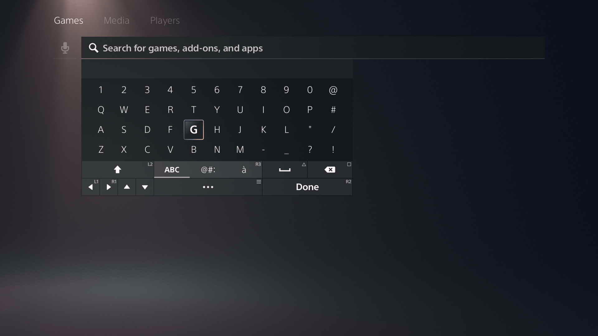

# PS5 controls and on-screen keyboard (hardware-verified 2026-10-30)

Every row marked ✅ was proven by a before/after capture-card frame, not by
GIMX saying `ok`. Config lives in [`config/controls.yaml`](../config/controls.yaml).

## Buttons

| Button | GIMX | Home screen | On-screen keyboard | |
|---|---|---|---|---|
| Cross | `cross` | Select / open | Type focused key | ✅ |
| Circle | `circle` | Back (closes menus, Control Center, search) | Close keyboard (keeps text) | ✅ |
| Square | `square` | — | Backspace | ✅ |
| Triangle | `triangle` | Jump focus to Search icon | Space | ✅ |
| D-pad | `up/down/left/right` | Move focus | Move focus (wraps left/right) | ✅ |
| Options | `start` | Item options menu | "…" menu | ✅ |
| PS | `PS` | Open Control Center | — | ✅ |
| L1 / R1 | `l1` / `r1` | Switch Games ↔ Media | Cursor left / right (R1 also picks 1st suggestion) | ✅ |
| L2 | `l2` | — | Shift | ✅ |
| R2 | `r2` | — | Done → focus 1st result | ✅ |
| R3 | `r3` | — | Accented-letters page | ✅ |
| Share, L3, sticks | | not yet verified | | ⏳ |

## Search flow

`open_home` → `open_search` → `keyboard.py type "<text>"` → `submit_search`.
Verified end to end with "mortal kombat" and "astro bot".

## Keyboard geometry (`ps5_system_en`)



```
row 0:  1 2 3 4 5 6 7 8 9 0 @
row 1:  q w e r t y u i o p #
row 2:  a s d f g h j k l ' /      (shift: " instead of ')
row 3:  z x c v b n m , . ? !      (shift: - _ instead of , .)
```

- Opens with focus on **g** and shift on (first letter is auto-capitalised).
- Left/right **wrap** within a row; **up from row 0 leaves the keyboard** into
  results — never do it.
- Below row 3 is the control strip; avoid it, use the shortcuts above.
- Search is case-insensitive, so verify typed text case-insensitively.
